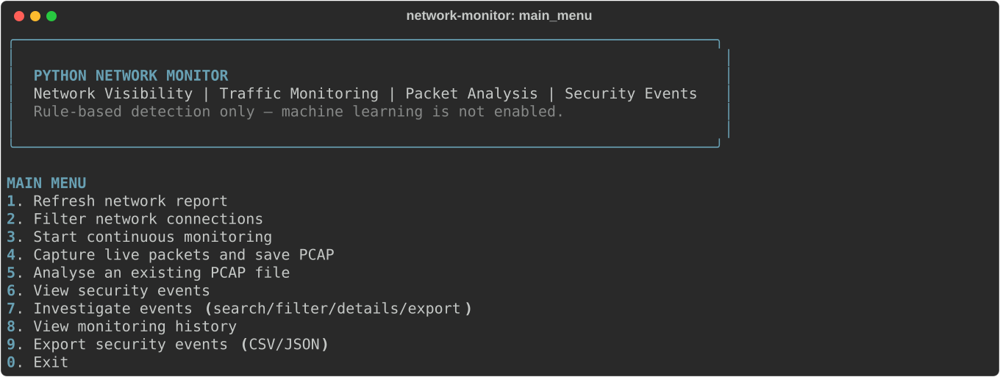
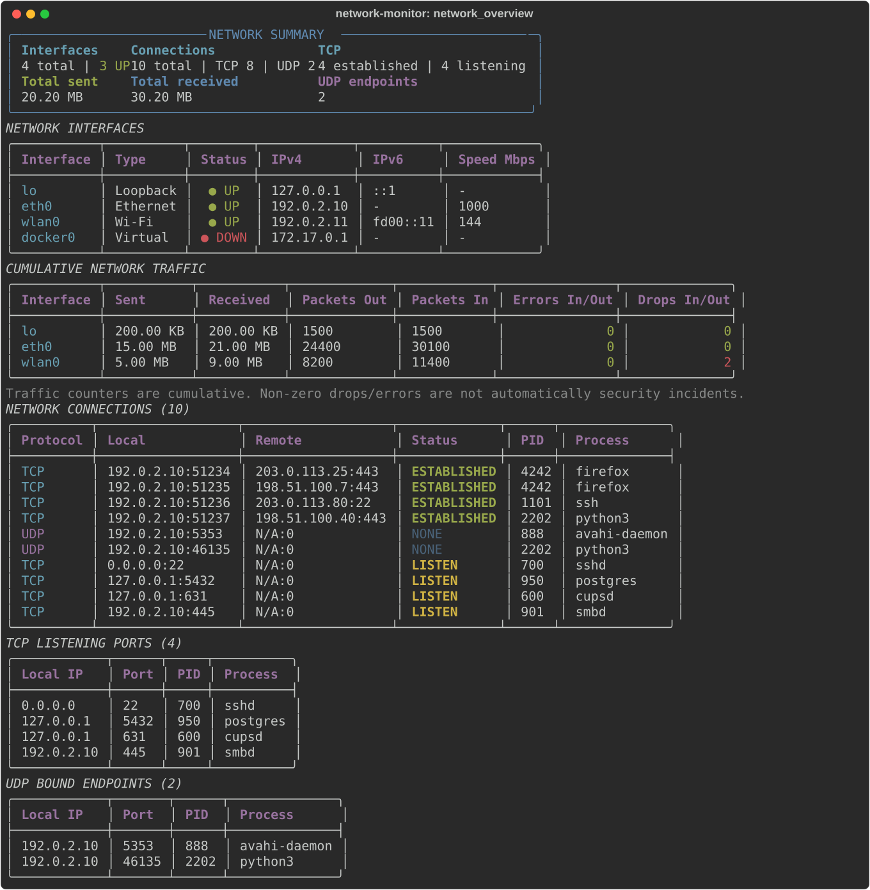
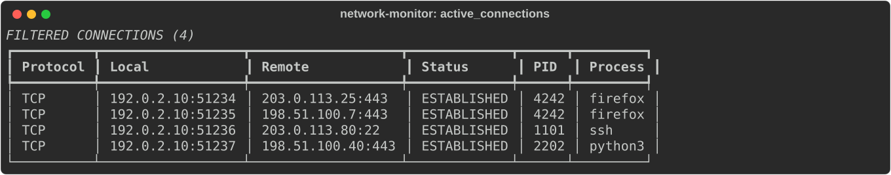
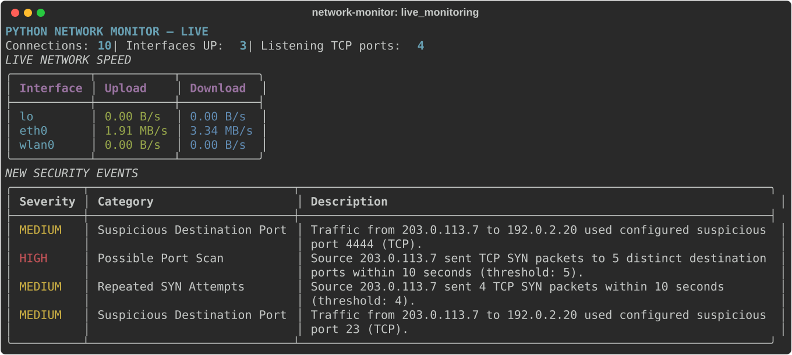
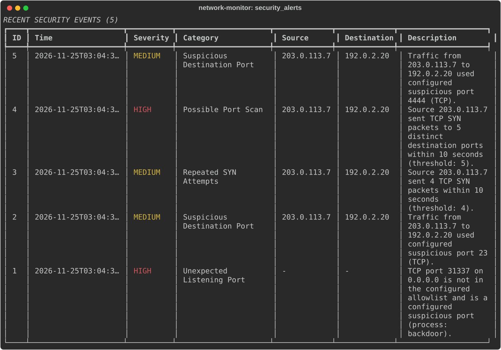
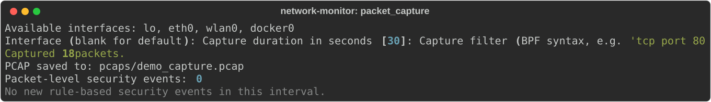
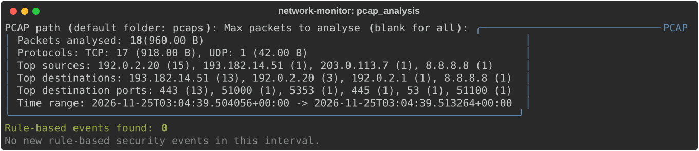
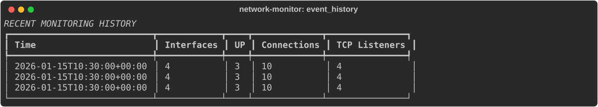
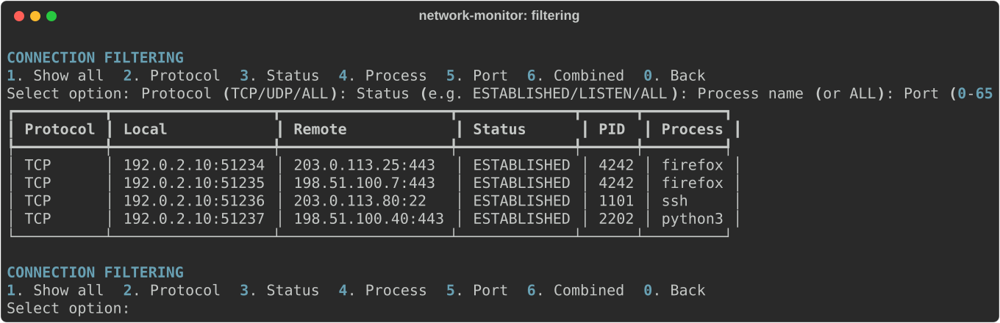

# Python Network Monitor

[](#18-testing-and-quality-assurance)
[](#151-requirements)
[](#28-license)
[](#151-requirements)

A terminal-based network monitoring and rule-based security event detection application developed using Python.

This project provides visibility into network interfaces, active connections, network traffic, listening services and suspicious network activities. It also supports live packet capture, offline PCAP analysis, event investigation, SQLite storage and CSV/JSON exports.

**Project status:** Completed initial implementation; further improvements planned.

**Project category:** Network Security / Cybersecurity
**Programming language:** Python
**Platform:** Linux
**Detection approach:** Rule-based detection
**Machine Learning:** Not included in this version

---

## Project Demonstration

The screenshots below demonstrate the main features of the application:

- Network monitoring.
- Active connection inspection.
- Live packet capture.
- PCAP analysis.
- Security event detection.
- Event investigation and export.

See the [Screenshots](#21-screenshots) section for the complete demonstration.

For a one-command guided tour of every implemented feature directly in the terminal, run:

```bash
python -m network_monitor.showcase
```

For a live web dashboard with auto-updating graphs and tables (no terminal input needed after startup), run:

```bash
python -m network_monitor.web
```

---

# Table of Contents

1. [Project Overview](#1-project-overview)
2. [Project Motivation](#2-project-motivation)
3. [Problem Statement](#3-problem-statement)
4. [Project Objectives](#4-project-objectives)
5. [Key Features](#5-key-features)
6. [System Architecture](#6-system-architecture)
7. [How the Complete System Works](#7-how-the-complete-system-works)
8. [Project Structure](#8-project-structure)
9. [Module Responsibilities](#9-module-responsibilities)
10. [Technologies and Libraries](#10-technologies-and-libraries)
11. [Network Concepts Used](#11-network-concepts-used)
12. [Rule-Based Detection Mechanisms](#12-rule-based-detection-mechanisms)
13. [Packet Capture and PCAP Analysis](#13-packet-capture-and-pcap-analysis)
14. [Event Investigation and Storage](#14-event-investigation-and-storage)
15. [Installation and Setup](#15-installation-and-setup)
16. [Running the Application](#16-running-the-application)
17. [Configuration](#17-configuration)
18. [Testing and Quality Assurance](#18-testing-and-quality-assurance)
19. [Manual Testing and Verification](#19-manual-testing-and-verification)
20. [Sample Outputs](#20-sample-outputs)
21. [Screenshots](#21-screenshots)
22. [Key Learning Outcomes](#22-key-learning-outcomes)
23. [Development Challenges and Solutions](#23-development-challenges-and-solutions)
24. [Limitations](#24-limitations)
25. [Future Improvements](#25-future-improvements)
26. [Learning Resources and Further Exploration](#26-learning-resources-and-further-exploration)
27. [Disclaimer](#27-disclaimer)
28. [License](#28-license)

---

# 1. Project Overview

Python Network Monitor is a modular cybersecurity application that monitors the network activity of a Linux computer.

It collects information about the computer's network interfaces, active network connections, listening services and traffic statistics.

It also analyses network connections and captured packets using predefined security rules to identify potentially suspicious activities.

The application provides a terminal-based interface through which users can:

- View network interfaces and their current status.
- Monitor incoming and outgoing network traffic.
- Identify active TCP and UDP connections.
- View listening ports and associated processes.
- Filter network connections.
- Monitor network activity continuously.
- Capture live network packets.
- Save captured packets as PCAP files.
- Analyse previously captured PCAP files.
- Detect suspicious network patterns.
- Store security events in an SQLite database.
- Investigate previously generated alerts.
- Export security events into CSV and JSON files.

### Important design decision

This project uses **rule-based detection**, not machine learning.

Each detection is based on predefined conditions, thresholds and observations. This makes the detection process understandable and explainable.

An alert indicates that a particular condition has been matched. It does not automatically prove that a cyberattack has occurred.

---

# 2. Project Motivation

Understanding network activity is an important part of cybersecurity and network security.

A computer communicates with other devices and services through network connections. During normal operation, many connections are created and terminated in the background.

However, some network activities may indicate suspicious behaviour, such as:

- Repeated connection attempts.
- Attempts to connect to multiple ports.
- Unusual listening services.
- High network traffic volume.
- Connections to suspicious destination ports.
- Unexpected changes in network interfaces.

Understanding these activities requires knowledge of network interfaces, IP addresses, ports, protocols, sockets and packets.

We developed this project to gain practical experience with these concepts by building a working network monitoring application instead of studying them only theoretically.

The project also provides a foundation for understanding how basic network monitoring and security event detection systems operate.

---

# 3. Problem Statement

A computer continuously communicates with other devices and services through its network interfaces.

Without appropriate monitoring, it can be difficult to understand:

- Which network interfaces are currently active?
- Which devices or servers is the computer communicating with?
- Which applications are creating network connections?
- Which ports are being used?
- How much data is being transferred?
- Which services are listening for incoming connections?
- Are there unusual connection patterns?
- What suspicious activities happened earlier?

Traditional network commands provide useful information, while packet analysis tools provide detailed network visibility.

However, beginners may find it difficult to combine these observations, identify suspicious patterns and maintain an investigation history.

This project addresses that learning and monitoring requirement by combining network information collection, packet analysis, rule-based detection, event storage and investigation within one Python application.

---

# 4. Project Objectives

The main objectives are:

1. Understand how network interfaces, IP addresses, ports, protocols and connections work.
2. Develop a Python application to collect network information from a Linux system.
3. Monitor network traffic and calculate incoming and outgoing data rates.
4. Understand how TCP and UDP connections can be inspected.
5. Capture live packets and save them for later analysis.
6. Analyse previously captured PCAP files.
7. Implement basic rule-based security detection mechanisms.
8. Identify potentially suspicious network activities.
9. Store security events and monitoring history using SQLite.
10. Develop investigation features to search, filter and inspect security events.
11. Export investigation results into CSV and JSON formats.
12. Apply software engineering practices such as modular development, exception handling and automated testing.

---

# 5. Key Features

The application is divided into several functional areas.

## 5.1 Network Overview

Displays information about the computer's network environment.

It includes:

- Network interface names.
- Interface status.
- IPv4 and IPv6 addresses.
- Link speed.
- Incoming traffic counters.
- Outgoing traffic counters.
- Active TCP and UDP connections.
- Associated process information where available.
- TCP listening services.
- UDP endpoints.

This feature helps users understand the current network state of their computer.

## 5.2 Network Connection Filtering

Users can filter network connections using:

- Protocol.
- Connection status.
- Process name.
- Port number.
- Combined filtering conditions.

For example, users can display only TCP connections or search for connections associated with a particular process.

## 5.3 Continuous Network Monitoring

The application periodically collects network information.

During monitoring, it:

- Collects network snapshots.
- Calculates incoming and outgoing traffic rates.
- Checks active connections.
- Applies detection rules.
- Stores monitoring history.
- Saves generated security events.

Traffic rates are calculated using the actual elapsed time between samples rather than assuming that every monitoring interval takes exactly the configured duration.

## 5.4 Live Packet Capture

The application uses Scapy to capture packets from a selected network interface.

Users can configure:

- Network interface.
- Capture duration.
- Maximum packet count.
- Optional BPF capture filter.

Captured packets are saved as PCAP files for later investigation.

## 5.5 Offline PCAP Analysis

Users can analyse previously captured PCAP files.

The analysis provides:

- Total packet count.
- Total captured data size.
- Protocol distribution.
- Packet and byte statistics.
- Top source IP addresses.
- Top destination IP addresses.
- Top destination ports.
- Capture time range.
- Security detection results.

The PCAP reader processes packets incrementally instead of loading the entire file into memory.

## 5.6 Rule-Based Security Detection

The application examines network activity using predefined rules.

It can identify patterns related to:

- Possible port scans.
- Repeated connection attempts.
- Possible DoS activity.
- Suspicious destination ports.
- Suspicious outbound connections.
- Unexpected listening services.
- Unusual connection frequency.
- High bandwidth usage.
- Network interface changes.

## 5.7 Security Event Investigation

Users can investigate previously generated events.

Available features include:

- Search events using an IP address.
- Filter by severity.
- Filter by event category.
- Apply combined filters.
- View individual event details.
- Examine detection evidence.
- View events in chronological order.
- Export filtered investigation results.

## 5.8 Database and Export

Security events and monitoring snapshots are stored in an SQLite database.

Users can export events into:

- CSV format.
- JSON format.

This allows the information to be used for further analysis and reporting.

---

# 6. System Architecture

The application follows a modular architecture.

Each module is responsible for a particular part of the system.

This is a conceptual overview, not an exact execution sequence:

```text
                  PYTHON NETWORK MONITOR
                            |
                            v
                         main.py
                   Application Controller
                            |
          +-----------------+-----------------+
          |                 |                 |
          v                 v                 v
      monitor.py      packet_tools.py     dashboard.py
          |                 |             Terminal UI
          v                 v
      collector.py      Scapy Capture
       (psutil)         and PCAP Analysis
          |                 |
          +--------+--------+
                   |
                   v
               detector.py
          Rule-Based Detection
                   |
                   v
               storage.py
             SQLite Database
                   |
                   v
          Investigation and Export
               CSV / JSON

       config.py  → Configuration
       filters.py → Connection Filtering
```

The exact data flow should be verified against the implementation.

### Architecture explanation

**Collection layer**

Collects network information from the operating system using psutil and packet information using Scapy.

**Processing layer**

Processes collected information, calculates traffic rates and prepares packet statistics.

**Detection layer**

Applies predefined security rules and generates events when suspicious conditions are observed.

**Storage layer**

Stores events and monitoring snapshots in an SQLite database.

**Presentation layer**

Uses Rich to display information in terminal tables and menus.

**Investigation and export layer**

Allows users to search, filter, inspect and export stored security events.

For more architectural details, see [docs/architecture.md](docs/architecture.md).

---

# 7. How the Complete System Works

The following steps explain the overall workflow.

## Step 1: Collect Network Information

The application uses psutil to communicate with the operating system.

It collects:

- Network interfaces.
- IP addresses.
- Network counters.
- Active connections.
- Listening sockets.
- Process information where available.

The collected information is passed to other modules for processing and display.

## Step 2: Display Network Information

The dashboard module uses Rich to display collected information in readable terminal tables.

Instead of displaying raw Python data structures, the application presents formatted information.

## Step 3: Monitor Network Activity

When continuous monitoring is started, the application collects network snapshots at regular intervals.

It compares network counter values between samples to calculate traffic rates.

For example:

If a computer transfers 2 MB of data during a two-second interval, the application calculates the corresponding transfer rate using the elapsed time.

## Step 4: Analyse Network Connections

The application examines available connections and listening services.

It checks connection patterns against configured rules.

Examples include:

- One remote IP connecting to multiple local ports.
- Repeated connections from one remote IP.
- Unexpected listening services.
- Unusual numbers of connections to a remote IP.

## Step 5: Capture and Analyse Packets

Scapy is used to capture packets from a network interface.

The packets are saved to a PCAP file.

The user can later select the file and analyse its contents.

The analysis process extracts packet information, calculates statistics and sends packet batches to the detection component.

## Step 6: Apply Security Detection Rules

The detector compares observed network activity against configured thresholds.

When a rule matches, it creates a security event.

Each event contains information such as:

- Event timestamp.
- Severity.
- Category.
- Source IP.
- Destination IP.
- Description.
- Detection rule.
- Observed values.
- Configured threshold.
- Relevant evidence.

## Step 7: Store Security Events

The storage module saves generated events and monitoring snapshots in SQLite.

This makes it possible to review previous activity even after the monitoring session ends.

## Step 8: Investigate and Export

The user can open the investigation menu to search and filter stored events.

Individual events can be inspected to understand why the detector generated an alert.

Investigation results can also be exported into CSV or JSON.

---

# 8. Project Structure

The project uses a modular directory structure.

```text
python-network-monitor/
│
├── config/
│   └── settings.json
│
├── data/
│   └── network_monitor.db
│
├── docs/
│   ├── architecture.md
│   └── demo.md
│
├── exports/
│
├── pcaps/
│
├── screenshots/
│   ├── main_menu.svg
│   ├── network_overview.svg
│   ├── active_connections.svg
│   ├── live_monitoring.svg
│   ├── security_alerts.svg
│   ├── packet_capture.svg
│   ├── pcap_analysis.svg
│   ├── event_history.svg
│   ├── filtering.svg
│   └── export_results.svg
│
├── scripts/
│   └── capture_screenshots.py
│
├── src/
│   └── network_monitor/
│       ├── __init__.py
│       ├── main.py
│       ├── config.py
│       ├── collector.py
│       ├── detector.py
│       ├── monitor.py
│       ├── storage.py
│       ├── dashboard.py
│       ├── packet_tools.py
│       └── filters.py
│
├── tests/
│   ├── __init__.py
│   ├── test_config.py
│   ├── test_detector.py
│   ├── test_filters.py
│   ├── test_packet_tools.py
│   └── test_storage.py
│
├── .gitignore
├── LICENSE
├── README.md
├── pyproject.toml
└── requirements.txt
```

> The `data/`, `exports/` and `pcaps/` directories are used for locally generated application data. These directories are excluded from Git to avoid uploading personal monitoring records, exported security events and captured network traffic.

### Important directories

| Directory | Responsibility |
|---|---|
| config/ | Application configuration |
| data/ | SQLite database |
| docs/ | Architecture and demonstration documentation |
| exports/ | Generated CSV and JSON files |
| pcaps/ | Captured network packet files |
| screenshots/ | Application screenshots |
| scripts/ | Supporting scripts |
| src/ | Main application source code |
| tests/ | Automated unit tests |

Generated database, capture and export files are excluded from Git using `.gitignore`.

---

# 9. Module Responsibilities

Understanding the individual modules is important because the application is developed using a modular design.

## 9.1 main.py — Application Entry Point

This is the main starting point of the application.

Responsibilities:

- Display the main menu.
- Accept user input.
- Call the relevant application functions.
- Handle menu navigation.
- Manage errors during user operations.
- Connect different modules.

It acts as the main controller of the application.

## 9.2 config.py — Configuration Management

Responsible for loading and validating application settings.

It reads values from `config/settings.json`.

Examples:

- Monitoring interval.
- Detection thresholds.
- Packet capture duration.
- Suspicious port list.
- Alert cooldown duration.

It also handles invalid configuration values and falls back to defaults when necessary.

## 9.3 collector.py — Network Information Collection

Responsible for collecting information from the operating system using psutil.

It collects:

- Network interfaces.
- IP addresses.
- Traffic counters.
- Active connections.
- Listening services.
- Process information where available.

Connection information is collected once per snapshot and reused for relevant views.

## 9.4 dashboard.py — Terminal Presentation

Responsible for displaying network information using Rich.

It creates readable terminal tables and panels for:

- Network overview.
- Active connections.
- Listening services.
- Traffic information.
- Packet analysis summaries.

## 9.5 monitor.py — Continuous Monitoring

Responsible for periodic monitoring.

It:

1. Collects network snapshots.
2. Calculates traffic rates.
3. Checks network activity.
4. Sends relevant information to the detector.
5. Saves monitoring history.
6. Stores generated events.

## 9.6 detector.py — Security Detection Engine

This is one of the most important components.

It contains the predefined detection rules.

It examines connection information and packet observations to identify suspicious patterns.

It also:

- Determines event severity.
- Generates evidence.
- Records observed values and thresholds.
- Applies alert cooldowns.
- Prevents repeated identical alerts from flooding the database.

## 9.7 packet_tools.py — Packet Capture and Analysis

Responsible for packet-related operations using Scapy.

It supports:

- Live packet capture.
- PCAP file creation.
- Offline PCAP reading.
- Packet information extraction.
- Protocol statistics.
- Top talker calculations.
- Packet filtering.
- Packet-based detection integration.

It processes PCAP files incrementally to reduce memory usage.

## 9.8 storage.py — Database Management

Responsible for SQLite operations.

It supports:

- Database initialization.
- Security event storage.
- Monitoring snapshot storage.
- Event retrieval.
- Event searching.
- Filtering.
- CSV export.
- JSON export.

It also manages database connections safely, including closing connections and rolling back unsuccessful transactions.

## 9.9 filters.py — Filtering Logic

Contains reusable filtering functions.

It supports filtering by:

- Protocol.
- Status.
- Port.
- Process name.
- Multiple combined conditions.

## 9.10 Test Modules

The test directory contains automated tests for the main application components.

Each test module checks the behaviour of a particular component.

This helps identify errors and ensures that changes do not unnecessarily break existing functionality.

---

# 10. Technologies and Libraries

| Technology | Purpose |
|---|---|
| Python | Main programming language |
| psutil | Collecting network interfaces, connections and traffic counters |
| Scapy | Capturing, reading and analysing network packets |
| Rich | Creating terminal tables and formatted output |
| SQLite | Storing security events and monitoring history |
| unittest | Automated testing |
| Git | Version control |
| GitHub | Source code hosting and portfolio presentation |
| Linux | Development and execution environment |

### Why Python?

Python provides useful libraries for interacting with operating systems, analysing network packets and implementing security monitoring logic.

It also makes it easier to divide the application into reusable modules.

### Why psutil?

psutil provides access to operating-system information such as network interfaces, network counters, sockets and processes.

### Why Scapy?

Scapy allows Python applications to capture, read, dissect and analyse network packets.

### Why SQLite?

SQLite provides a lightweight database that does not require a separate database server.

It is suitable for storing the events and monitoring history generated by this application.

### Why Rich?

Rich improves the terminal experience by presenting information in formatted tables, panels and other readable layouts.

---

# 11. Network Concepts Used

This project helped us understand several important networking concepts.

## 11.1 Network Interfaces

A network interface is a connection point that allows a computer to communicate with a network.

Examples include:

- Ethernet.
- Wi-Fi.
- Loopback.

The application collects information about available interfaces and their status.

## 11.2 IP Addresses

An IP address identifies a network endpoint.

The application works with IPv4 and IPv6 addresses when collecting connection and packet information.

## 11.3 MAC Addresses

A MAC address is a hardware-level network identifier associated with a network interface.

This version focuses on IP-level interface information and does not display MAC addresses.

## 11.4 TCP and UDP

TCP and UDP are transport-layer protocols.

**TCP:**
- Connection-oriented.
- Provides reliable data delivery.
- Commonly used by web and application services.

**UDP:**
- Connectionless.
- Does not provide the same delivery guarantees as TCP.
- Commonly used by DNS, streaming and discovery protocols.

The application collects and analyses both TCP and UDP connection information.

## 11.5 Ports

Ports identify application-level communication endpoints.

Examples:

| Port | Common service |
|---|---|
| 22 | SSH |
| 53 | DNS |
| 80 | HTTP |
| 443 | HTTPS |
| 5432 | PostgreSQL |
| 5353 | mDNS |

The project uses port information when filtering connections and identifying potentially suspicious activities.

## 11.6 Network Traffic Counters

Network counters record transferred data and packet statistics.

The application uses these counters to calculate incoming and outgoing traffic rates.

## 11.7 Network Sockets

A socket is an endpoint used by an application for network communication.

By examining available socket information, the application can identify active connections and listening services.

## 11.8 Network Packets

Network communication is carried through packets.

Each packet contains information such as source and destination addresses, protocol information and other headers.

Scapy is used to capture and examine these packets.

## 11.9 PCAP Files

PCAP files store captured network packets.

They allow network activity to be examined later without performing another live capture.

This project supports saving and analysing PCAP files.

## 11.10 BPF Filters

Berkeley Packet Filter (BPF) expressions allow users to select particular packets during capture.

For example:

```text
tcp
```

Captures TCP traffic.

```text
udp
```

Captures UDP traffic.

```text
port 443
```

Selects traffic associated with port 443.

---

# 12. Rule-Based Detection Mechanisms

The application uses predefined rules to identify potentially suspicious network patterns.

The rules are configurable through `config/settings.json`.

## 12.1 Possible Port Scan

A port scan occurs when a source examines multiple ports on a target system.

The application checks:

- TCP SYN packets targeting different destination ports.
- Inbound connection history involving different local ports.
- Outbound connections involving different remote ports.

Default threshold:

- 15 distinct ports within the relevant detection window.

## 12.2 Repeated SYN Attempts

The application examines repeated TCP SYN packets from the same source.

A high number of SYN attempts within a short period may indicate connection probing or other suspicious activity.

Default threshold:

- 10 SYN packets within 10 seconds.

## 12.3 Repeated Connection Attempts

The application checks whether one remote IP address creates repeated distinct connection attempts.

Default threshold:

- 10 connections within 10 seconds.

## 12.4 Possible DoS Pattern

A Denial-of-Service attack attempts to make a system or service unavailable by overwhelming it with requests or traffic.

The application uses packet count and byte volume to identify unusually high traffic from one source.

Default thresholds:

- 100 packets within 10 seconds, OR
- 1 MiB of data within 10 seconds.

**Important:** These are simple threshold-based indicators. Normal network discovery and multicast traffic can also trigger them. A high packet count alone does not establish that a DoS attack is occurring.

## 12.5 Suspicious Destination Ports

The application checks whether packets are directed towards configured suspicious ports.

Default list:

- 23
- 2323
- 4444
- 5555
- 6667
- 31337

These ports are treated as indicators for further investigation, not proof of malicious activity.

## 12.6 Suspicious Outbound Connections

The application checks established outbound connections to configured suspicious destination ports.

## 12.7 Unexpected Listening Services

A listening service waits for incoming network connections.

The application compares listening TCP ports against a configurable allowlist.

Default allowlist:

- 22
- 53
- 80
- 443
- 631
- 5432

A listening port outside this list can generate an alert.

An unlisted port is not automatically malicious. The expected services depend on the computer and its configuration.

## 12.8 Connection Frequency

The application checks whether there are unusually many simultaneous connections to one remote IP address.

Default threshold:

- 15 simultaneous connections.

## 12.9 High Bandwidth Usage

The application monitors interface traffic rates.

Default threshold:

- 10 MiB/s.

## 12.10 Network Interface Changes

The application detects interface changes after establishing an initial baseline.

Examples:

- A new interface appears.
- An interface changes state.
- An existing interface disappears.

## 12.11 Alert Cooldown

Repeatedly generating the same alert can make investigation difficult.

To reduce duplicate events, the application uses cooldown periods.

Default cooldown:

- 60 seconds.

This means that a repeated matching condition may not create another identical alert during the cooldown period.

---

# 13. Packet Capture and PCAP Analysis

Packet capture is an important practical component of this project.

It provides an opportunity to understand network communication at packet level.

## 13.1 Live Packet Capture

The application uses Scapy to capture packets from a selected network interface.

The user can specify:

- Interface.
- Duration.
- Maximum number of packets.
- Optional BPF filter.

The captured packets are written to a PCAP file.

## 13.2 Offline PCAP Analysis

After capturing packets, the user can analyse the PCAP file.

The application reads the packets incrementally and calculates statistics.

For example, it can identify:

- How many packets were captured.
- Which protocols were used.
- Which IP addresses communicated.
- Which destination ports appeared frequently.
- How much data was transferred.

## 13.3 Why Offline Analysis Is Useful

Live network activity happens continuously.

It may not always be possible to investigate everything while capturing packets.

PCAP files provide a way to preserve network observations and analyse them later.

This is also useful when learning Wireshark and understanding how packet-analysis tools work.

## 13.4 Relationship with Wireshark

Wireshark is a separate network protocol analyser.

The PCAP files generated by this project can also be opened in Wireshark.

This provides an opportunity to compare:

- The statistics produced by our Python application.
- The packet-level details displayed by Wireshark.

---

# 14. Event Investigation and Storage

Generating alerts is only one part of security monitoring.

It is also important to store, review and investigate those alerts.

## 14.1 SQLite Database

The application uses SQLite to store:

- Security events.
- Monitoring snapshots.

The database is stored under:

```text
data/network_monitor.db
```

## 14.2 Security Event Information

Each event can contain:

- Event ID.
- Timestamp.
- Severity.
- Category.
- Source IP.
- Destination IP.
- Description.
- Additional detection evidence.

## 14.3 Investigation Workflow

The investigation feature provides a way to:

1. Search events using an IP address.
2. Filter events by severity.
3. Filter events by category.
4. Apply combined filters.
5. Select and inspect individual events.
6. View an event timeline.
7. Export the filtered results.

## 14.4 CSV and JSON Export

The application supports two export formats.

**CSV**

Useful for spreadsheet applications and tabular analysis.

**JSON**

Useful for structured data processing and integration with other software.

The exported information can be used for further investigation and reporting.

---

# 15. Installation and Setup

## 15.1 Requirements

- Linux operating system.
- Python 3.10 or newer.
- Git.
- Internet connection for initial dependency installation.
- Elevated packet-capture permissions for live capture.

The project was developed and tested in an Ubuntu environment.

## 15.2 Clone the Repository

```bash
git clone https://github.com/nimesha-dev/python-network-monitor.git
cd python-network-monitor
```

Replace the repository placeholder with the actual GitHub repository address.

## 15.3 Create a Virtual Environment

```bash
python3 -m venv .venv
```

## 15.4 Activate the Virtual Environment

```bash
source .venv/bin/activate
```

## 15.5 Install Dependencies

```bash
python -m pip install --upgrade pip
python -m pip install -e .
```

The editable installation makes the application available as an installed Python package while allowing changes to the source code.

---

# 16. Running the Application

After installing the dependencies and activating the virtual environment, view every implemented feature in one guided dashboard tour:

```bash
python -m network_monitor.showcase
```

The showcase prints a single read-only report: project summary, active configuration, live network overview, connection filtering, the catalogue of all 11 detection rules with current thresholds, the detection engine on live data, a synthetic alert with full evidence, traffic-rate monitoring, offline PCAP analysis, event storage and investigation, CSV/JSON export, the automated test results and a feature index. No elevated privileges are required.

For a live web dashboard in the browser — auto-refreshing tables and charts with no terminal input after startup — run:

```bash
python -m network_monitor.web
```

This starts a local server on `http://127.0.0.1:8765/` and opens the page automatically. It shows KPI cards, a live upload/download rate chart, events by severity, interface and connection tables, top processes by connections, TCP listeners and recent security events — all refreshing every 2 seconds from a background monitor thread. The page is interactive: pause/resume the live view, filter and search connections and events, sort any table column, click a severity chart bar to filter, click an event row to inspect its full evidence JSON, and download all stored events as CSV/JSON. Use `--port` to change the port and `--no-browser` to skip opening the browser. Packet capture stays in the interactive application.

For the interactive application, run:

```bash
python -m network_monitor.main
```

The application displays the main menu.

```text
MAIN MENU

1. Refresh network report
2. Filter network connections
3. Start continuous monitoring
4. Capture live packets and save PCAP
5. Analyse an existing PCAP file
6. View security events
7. Investigate events (search/filter/details/export)
8. View monitoring history
9. Export security events (CSV/JSON)
0. Exit
```

Select an option to access the required functionality.

## Packet Capture Permissions

Linux packet capture generally requires appropriate privileges.

For a capture session, the application can be run using:

```bash
sudo .venv/bin/python -m network_monitor.main
```

Other monitoring, investigation, offline PCAP analysis and export operations do not normally require elevated privileges.

An alternative is to configure suitable capabilities for the Python executable. However, this changes the executable's security permissions and should only be done when understood and necessary.

---

# 17. Configuration

Application settings are maintained in:

```text
config/settings.json
```

Example configuration (matches `config/settings.json`):

```json
{
    "monitor_interval": 2.0,
    "packet_capture_duration": 30,
    "port_scan_threshold": 15,
    "repeated_attempt_threshold": 10,
    "dos_packet_threshold": 100,
    "detection_window_seconds": 10,
    "unusual_remote_connection_threshold": 15,
    "suspicious_ports": [
        23,
        2323,
        4444,
        5555,
        6667,
        31337
    ],
    "allowed_listening_ports": [
        22,
        53,
        80,
        443,
        631,
        5432
    ],
    "high_bandwidth_threshold_bps": 10485760
}
```

### Supported settings not present in the file

`config.py` supports the following additional settings. When they are absent from `settings.json`, the defaults shown below are used:

| Setting | Default | Purpose |
|---|---:|---|
| `dos_byte_threshold` | 1048576 | Byte volume threshold for the possible DoS rule |
| `connection_window_seconds` | 60 | Detection window for connection-based rules |
| `alert_cooldown_seconds` | 60 | Cooldown period for suppressing duplicate alerts |

These settings are implemented and validated by `config.py`, and they are used by `detector.py`.

### Configuration validation

The configuration module checks the values before using them.

It handles:

- Missing configuration files.
- Invalid JSON.
- Incorrect data types.
- Out-of-range values.
- Missing configuration fields.
- Duplicate port values.

Invalid values fall back to default settings where applicable.

This prevents many configuration mistakes from crashing the application.

---

# 18. Testing and Quality Assurance

Automated testing was an important part of the project development process.

We created separate test modules for the main components.

Run the test suite using:

```bash
python -m unittest discover -s tests -v
```

## Test Coverage

| Test module | Main coverage |
|---|---|
| test_config.py | Configuration loading, validation, defaults and invalid values |
| test_detector.py | Detection rules, thresholds, cooldowns and evidence |
| test_filters.py | Protocol, port, status, process and combined filtering |
| test_packet_tools.py | Packet processing, PCAP analysis and error handling |
| test_storage.py | SQLite storage, event searching, history and exports |

## Latest Automated Test Results

The latest full test run produced:

| Result | Count |
|---|---:|
| Total tests | 142 |
| Passed | 141 |
| Skipped | 1 |
| Failed | 0 |

One packet-capture test was skipped because it requires elevated privileges and a suitable capture environment.

**Overall result:**

```text
Ran 142 tests

OK (skipped=1)
```

No automated test failures were reported.

## Additional Code Check

The application source and tests can also be checked for Python compilation errors:

```bash
python -m compileall -q src tests
```

---

# 19. Manual Testing and Verification

In addition to automated tests, we manually tested the application's main functionality.

| Test | Expected result | Status |
|---|---|---|
| Network overview | Display network interfaces and traffic information | Passed |
| Connection filtering | Filter connections using selected conditions | Passed |
| Continuous monitoring | Display periodic network activity and traffic rates | Passed |
| Live packet capture | Capture packets and save a PCAP file | Passed |
| Offline PCAP analysis | Read packets and calculate statistics | Passed |
| Event investigation | Search, filter and inspect security events | Passed |
| CSV export | Export filtered events | Passed |
| Monitoring history | Display previously stored monitoring snapshots | Passed |
| JSON export | Export events into structured JSON | Passed |
| JSON validation | Validate the exported JSON structure | Passed |
| Automated tests | Run the complete unit test suite | Passed |

### Example manual verification

A live packet capture was performed on the Wi-Fi interface.

The application captured 523 packets and saved them into a PCAP file.

The PCAP analysis then reported packet and protocol statistics.

This verified the connection between live packet capture, PCAP storage and offline packet analysis.

### Important testing observation

During live testing, some normal network traffic generated possible DoS alerts.

For example, multicast and discovery traffic can produce a high packet count within a short time.

This highlighted an important cybersecurity lesson: detection rules must be evaluated against real network behaviour, not only artificial test cases.

An alert must be investigated before concluding that an attack occurred.

---

# 20. Sample Outputs

## 20.1 Event Investigation

```text
EVENT INVESTIGATION

1. Search by IP
2. Filter by severity
3. Filter by category
4. Combined filter (IP + severity + category)
5. View event details
6. Event timeline
7. Export last results
0. Back
```

## 20.2 Example Detection Evidence

The following is an illustrative event showing the type of evidence the detector can provide.

```json
{
    "rule": "packet_port_scan",
    "variant": "packet-based",
    "threshold": 15,
    "window_seconds": 10,
    "observed": {
        "distinct_destination_ports": 15
    },
    "sample_destination_ports": [
        21, 22, 23, 25, 53,
        80, 110, 143, 443, 445,
        993, 995, 3306, 5432, 8080
    ]
}
```

This example represents a possible port-scan pattern.

It does not establish that an actual attack has occurred.

## 20.3 PCAP Analysis

Output from analysing the sample capture `pcaps/capture_20261124_113151.pcap` (simplified for readability):

```text
Packets analysed: 523

Protocol distribution:
UDP: 505
TCP: 12
Other: 6

Top destination ports:
5353 - mDNS
5355 - LLMNR
443  - HTTPS
```

## 20.4 Exported Files

Example generated files:

```text
exports/
    security_events_20261124_171018.csv
    security_events_20261124_171255.json
```

The exported JSON was also validated using Python's JSON tool.

---

# 21. Screenshots

The following screenshots demonstrate the application's main features.

Screenshots are generated using the supporting script:

```bash
python scripts/capture_screenshots.py
```

| Feature | Screenshot |
|---|---|
| Main menu |  |
| Network overview |  |
| Active connections |  |
| Live monitoring |  |
| Security alerts |  |
| Packet capture |  |
| PCAP analysis |  |
| Event history |  |
| Filtering |  |
| Export results |  |

---

# 22. Key Learning Outcomes

This project was developed as a practical learning experience in network security and Python application development.

The main learning outcomes are described below.

## 22.1 Networking Fundamentals

We learned how to work with:

- Network interfaces.
- IPv4 and IPv6 addresses.
- TCP and UDP.
- Ports.
- Network sockets.
- Listening services.
- Network traffic counters.

We also gained practical experience inspecting network information directly from a Linux system.

## 22.2 Linux Networking

We learned how to use Linux networking tools and commands to understand the state of a computer's network.

This included inspecting interfaces, connection information and network activity.

## 22.3 Python for Cybersecurity

We learned how Python can be used to develop security-related tools.

Important concepts included:

- Working with external libraries.
- Reading operating-system information.
- Processing network data.
- Handling exceptions.
- Working with files.
- Organising a modular Python application.

## 22.4 Packet Analysis

We gained practical experience with:

- Capturing network packets.
- Understanding packet information.
- Working with Scapy.
- Saving PCAP files.
- Reading existing PCAP files.
- Extracting packet statistics.
- Applying packet filters.

## 22.5 Basic Network Security Detection

We learned how simple detection rules can identify suspicious network patterns.

This included understanding:

- Port scanning.
- Repeated connection attempts.
- Possible DoS patterns.
- Suspicious ports.
- Unexpected listening services.
- High bandwidth usage.

We also learned why detection thresholds need to be selected carefully.

## 22.6 Database Management

We learned how to use SQLite to:

- Create and initialise a database.
- Store security events.
- Store monitoring snapshots.
- Retrieve records.
- Search and filter records.
- Export structured data.

## 22.7 Software Engineering

We applied several software engineering practices:

- Modular architecture.
- Separation of responsibilities.
- Reusable functions.
- Configuration management.
- Input validation.
- Exception handling.
- Automated unit testing.
- Documentation.
- Version control.

## 22.8 Investigation and Evidence

We learned that detecting suspicious activity is not the final step.

Security events need to be stored, reviewed and investigated.

The evidence associated with an alert helps explain which condition caused the detection.

## 22.9 Practical Problem-Solving

During development, we encountered issues involving:

- Packet capture permissions.
- Network interface selection.
- Invalid configuration values.
- PCAP processing.
- Database connection handling.
- Duplicate alerts.
- Normal traffic triggering detection rules.

Working through these issues helped us understand how software behaves in a real operating environment.

---

# 23. Development Challenges and Solutions

The development process involved several practical challenges.

| Challenge | What we did |
|---|---|
| Accessing network information | Used psutil to collect interfaces, counters and connections |
| Packet capture permissions | Identified the Linux privileges required for live capture |
| Processing large PCAP files | Used incremental packet processing rather than loading entire files into memory |
| Repeated alerts | Implemented cooldown-based duplicate suppression |
| Invalid configuration | Added configuration validation and default values |
| Database resource management | Improved connection closing, transaction handling and rollback behaviour |
| Filtering multiple conditions | Implemented reusable filtering functions |
| Maintaining code quality | Created separate modules and automated tests |
| Normal traffic triggering alerts | Identified the need to evaluate thresholds against real traffic |

These challenges helped us move from simply writing Python code to understanding how a complete monitoring application behaves.

---

# 24. Limitations

This application is an educational and portfolio-level network monitoring tool.

It has several limitations.

### Local Host Monitoring

The application primarily monitors the local computer.

It is not a network-wide intrusion detection system.

### No Machine Learning

This version uses predefined detection rules and thresholds.

Machine-learning-based anomaly detection is outside the scope of this project.

### No Payload Decryption

The application does not decrypt encrypted network traffic.

Its detection capabilities are primarily based on available metadata, packet information and connection patterns.

### Possible False Positives

Normal network activity can sometimes match detection thresholds.

For example, multicast and discovery traffic may generate high packet counts.

Therefore, alerts require further investigation.

### Possible False Negatives

Simple thresholds may not identify slow or carefully distributed attacks.

### Permission Restrictions

Some operating-system information may be incomplete without sufficient permissions.

Live packet capture requires appropriate Linux capabilities.

### Operating System Support

The application was developed and tested on Linux.

Windows and macOS support have not been verified.

### Not a Replacement for Professional Security Tools

This project is not intended to replace enterprise IDS, IPS, SIEM or professional network security monitoring platforms.

### Authorized Use

Only monitor systems and networks that you own or have permission to assess.

---

# 25. Future Improvements

The current version focuses on building a reliable and understandable rule-based network monitoring application.

Possible future improvements, in priority order:

1. Reduce false positives from normal network traffic.
2. Improve detection accuracy with more comprehensive rules.
3. Add more comprehensive IPv6 support, including extension-header handling.
4. Improve alert investigation and reporting, including acknowledgement and investigation status.
5. Add additional network traffic analysis features and visualisation.

Other possible improvements include:

- Per-interface packet capture selection.
- Geolocation enrichment of remote IP addresses.

The following features are deliberately outside the scope of this version:

- Machine-learning-based anomaly detection.
- Web-based dashboard.
- Remote monitoring interface.
- User authentication.
- SIEM integration.
- Distributed multi-host monitoring.
- Cloud deployment.

Machine learning and more advanced detection approaches can be explored in a separate project after establishing a strong foundation in network monitoring and packet analysis.

---

# 26. Learning Resources and Further Exploration

The following tools and resources are useful for continuing to explore the concepts introduced in this project.

| Tool / Resource | Learning purpose |
|---|---|
| [Wireshark](https://www.wireshark.org/) | Visual network packet analysis |
| [Scapy Documentation](https://scapy.readthedocs.io/) | Python packet manipulation and analysis |
| [psutil Documentation](https://psutil.readthedocs.io/) | Operating-system and network monitoring |
| [Python Documentation](https://docs.python.org/3/) | Python programming |
| [Linux Manual Pages](https://man7.org/linux/man-pages/) | Linux networking commands and system operations |
| [SQLite Documentation](https://www.sqlite.org/docs.html) | Database fundamentals |
| [Git Documentation](https://git-scm.com/doc) | Version control |

---

# 27. Disclaimer

This project was developed for educational purposes and authorized network monitoring.

The detection rules provide indicators of potentially suspicious activity, not definitive evidence of cyberattacks.

Always obtain permission before monitoring or capturing network traffic.

---

# 28. License

This project is distributed under the license included in the repository.

See [LICENSE](LICENSE) for details.

---

**Project:** Python Network Monitor
**Focus:** Network Security, Network Monitoring and Rule-Based Detection
**Implementation:** Python, psutil, Scapy, Rich and SQLite
**Purpose:** Practical cybersecurity learning and portfolio development
